# 从第一次Fork，到第一份PR 🌱

准备一台电脑和浏览器即可，你可以慢慢来，每完成一步就停下来看看。

我们会用到几个英文按钮，下面保留按钮原文，并解释它们的意思。

| 页面上的词 | 实际含义 |
| --- | --- |
| Repository / Repo | 仓库，一个存放所有项目文件的空间 |
| Fork | 分叉，把原项目复制到自己的账号，得到有编辑权限的副本 |
| Markdown / `.md` | 一种文件格式，用普通文字加简单符号排版 |
| Commit changes | 提交修改，保存一次改动，并留下说明 |
| Branch | 分支，项目的“平行宇宙”版本，可多条 |
| Pull Request / PR | 申请合并，副本的某条“平行宇宙”，申请加入原项目，原项目会给予回复 |

## 0. 注册并登录

打开 [GitHub](https://github.com)，点击 **Sign up** 注册，填写页面信息，完成邮箱验证。

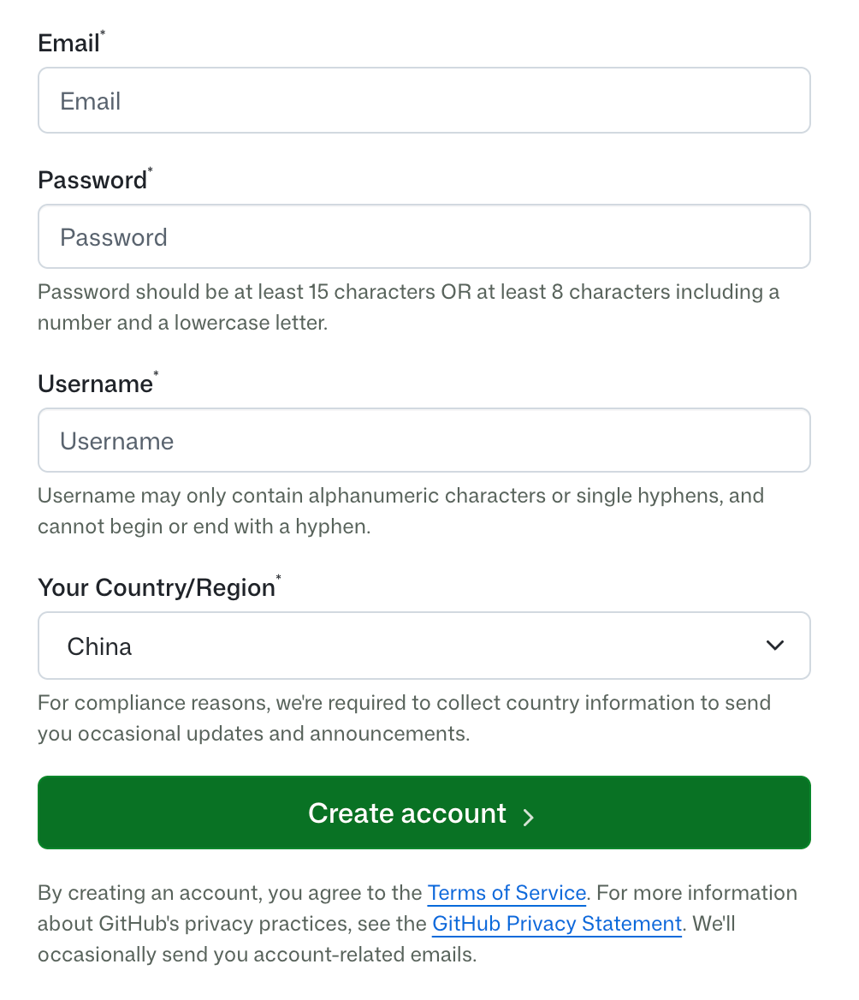

注册成功后，登录你的账号：

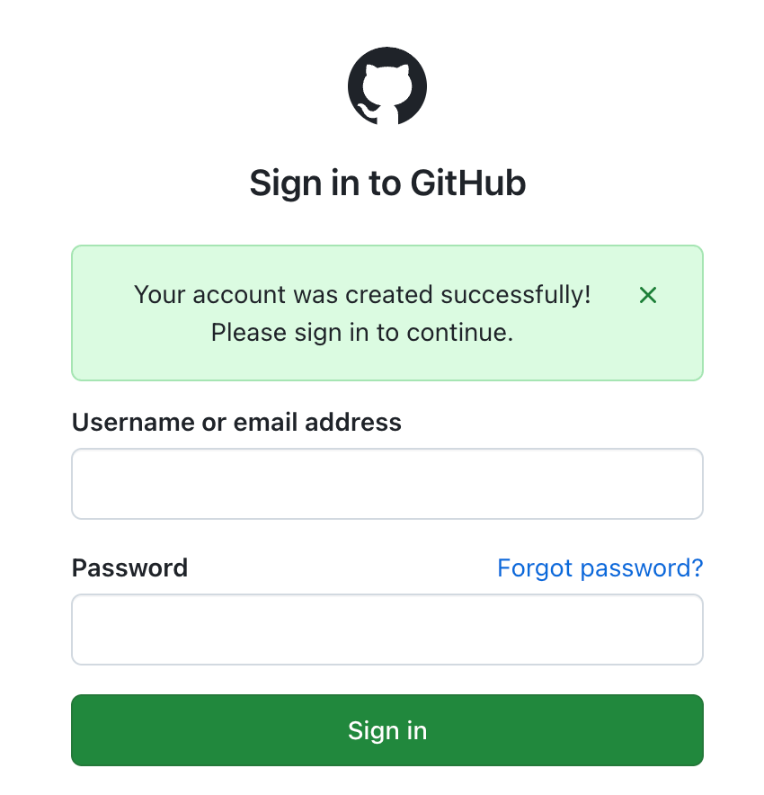

注意⚠️：这是一个公开项目，参与的过程中，你的头像、昵称、邮箱和PR记录，可以被大家看到，提交历史也可能保留旧内容，因此要注意只写自己愿意留下的内容。

## 1. Fork：得到自己的副本

1. 打开 [一颗种子原仓库](https://github.com/Hertz-chat/seed)。
2. 点击右上角 **Fork**。

   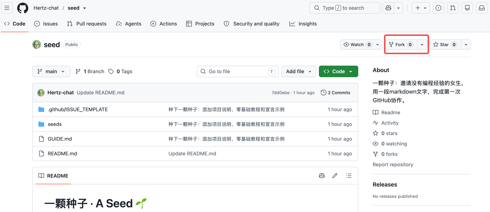
3. 确认 **Owner** 是你自己的账号，其他什么都不用改，保持默认设置即可，点击 **Create fork**。

   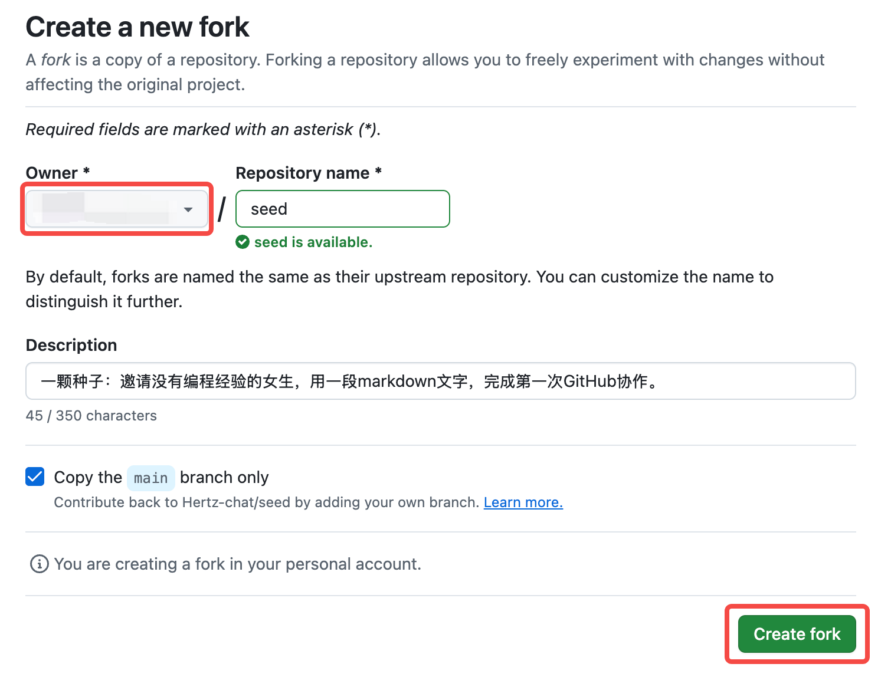

**停下来确认：** 页面左上角应该变成 `你的用户名 / seed`，项目名下方有 `forked from Hertz-chat/seed`。

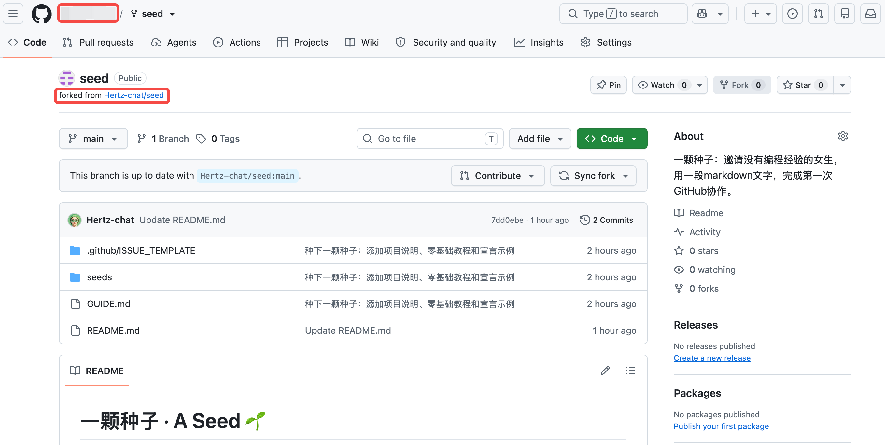

如果已经 Fork 过，直接打开自己的副本即可，不用重复创建。

## 2. 撰写你的第一份Markdown文件

1. 在副本首页，点击 **Add file → Create new file**按钮。窗口窄时按钮可能收进菜单，试着放大窗口。

   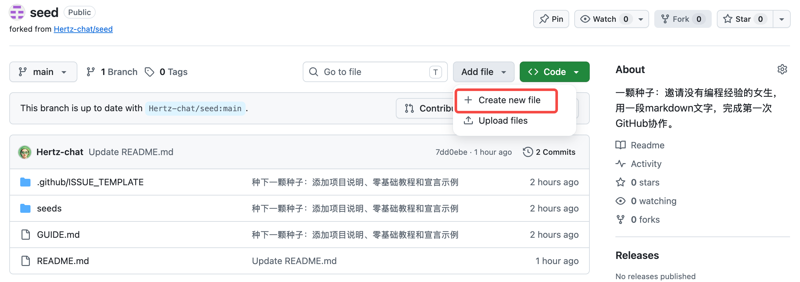
2. 在文件名输入框填写 `你的GitHub用户名.md`，假设用户名是 `八两Hertz`，就写 `八两Hertz.md`，并且撰写正文。`# `（井号后加一个空格）会把这一行变成标题，切换段落的话，在文字之间空一行即可。
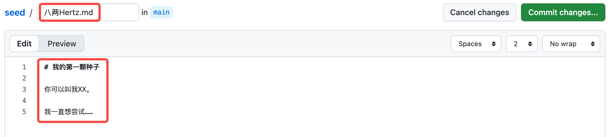

3. 点击 **Preview** 可以看到排版，点击 **Commit changes…** 提交修改。
   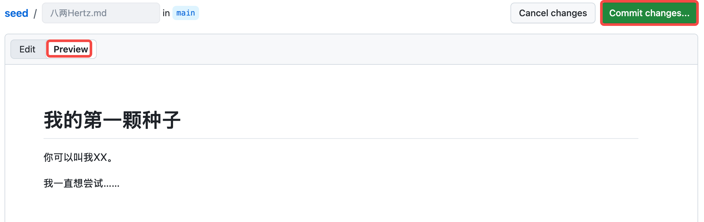

4. 在 **Commit message** 写「种下我的第一颗种子」，选择 **Create a new branch for this commit and start a pull request**，给新分支起名 `my-first-seed`，点击 **Propose changes**。

   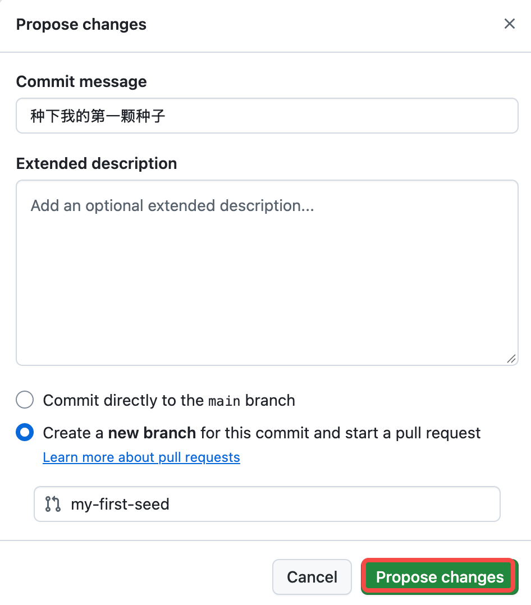

**停下来确认：** 看到**Comparing changes**页面，里面有你刚才新增的内容。
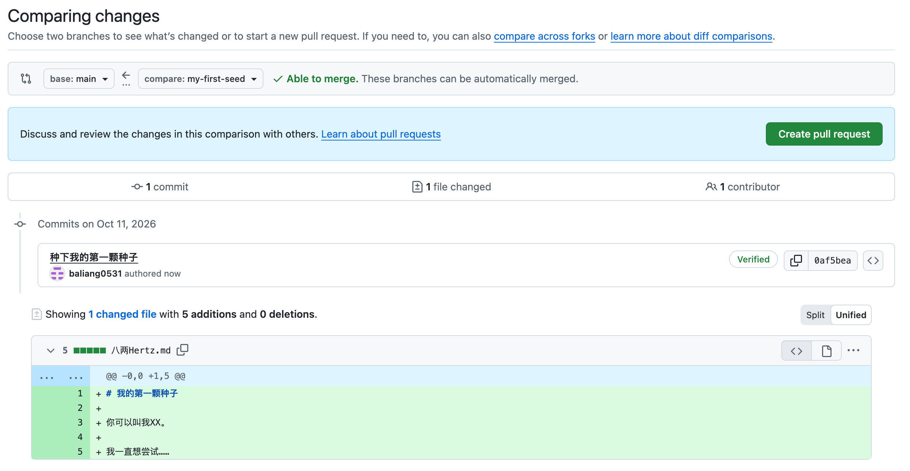

## 3. 给原仓库提PR

1. 打开 [一颗种子原仓库](https://github.com/Hertz-chat/seed)，点击**Compare & pull request**。

   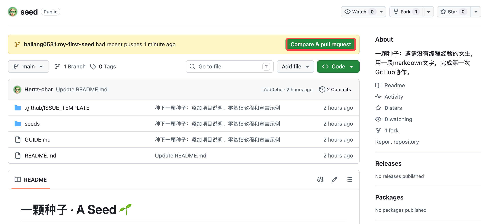

2. 填写以下内容，并点击**Create pull request** 提交即可：

- 标题：`种下我的第一颗种子`
- 说明：`这是我的第一次PR，请帮我看看～`

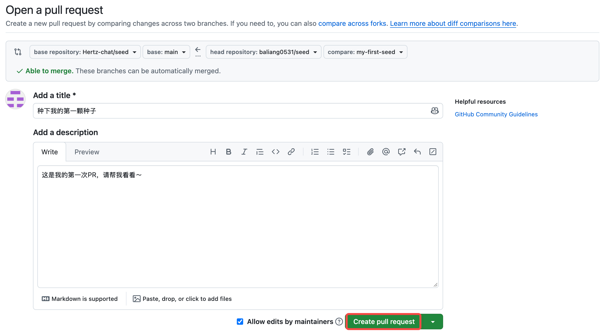

提交前确认上方的 **base repository** 是 `Hertz-chat/seed`、**base** 是 `main`，右侧是你的副本和 `my-first-seed` 分支。

**恭喜，你已经完成了第一次探索！** 我会查看PR并合并，请耐心等待，合并后你的头像和文件就都会出现在原仓库了～

> 如果执行过程中或者完成后，有任何疑问。可以在你的PR里评论，我会给你答复～你没有义务第一次就熟悉这些按钮！